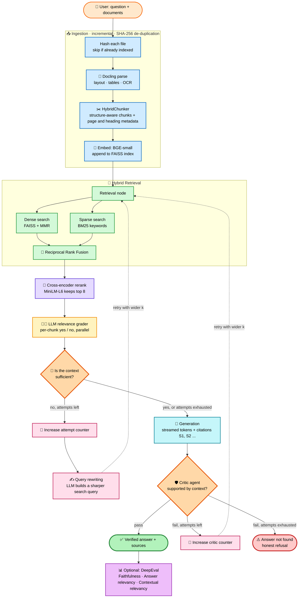
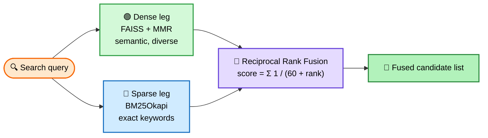
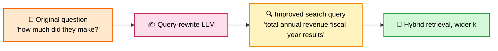
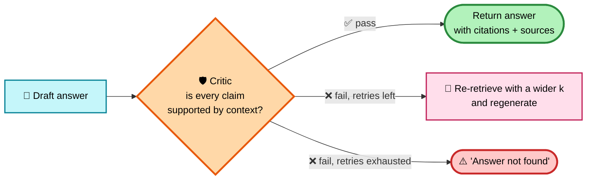

<div align="center">

# 🧬 OmniRAG

### An agentic, self-correcting Retrieval-Augmented Generation system
**Hybrid retrieval · Cross-encoder reranking · Query rewriting · Hallucination critic · Built-in evaluation**


*Upload documents → ask questions → get grounded, cited, fact-checked answers → score them.*

</div>

---

## 📑 Table of Contents

1. [✨ What is OmniRAG?](#-what-is-omnirag)
2. [🗺️ The Pipeline at a Glance](#️-the-pipeline-at-a-glance)
3. [🤖 Agentic Features](#-agentic-features)
4. [📄 Why Docling?](#-why-docling)
5. [🔎 Hybrid Retrieval](#-hybrid-retrieval-vector--bm25--rrf)
6. [🎯 Cross-Encoder Reranking](#-cross-encoder-reranking)
7. [✍️ Query Rewriting](#️-query-rewriting)
8. [🛡️ Hallucination Detection (Critic)](#️-hallucination-detection-the-critic-agent)
9. [📊 Evaluation with DeepEval](#-evaluation-with-deepeval)
10. [🧠 Models Used](#-models-used)
11. [🗂️ Persistent Knowledge Collections](#️-persistent-knowledge-collections)
12. [🖥️ The User Interface](#️-the-user-interface)
13. [⚙️ Tunable Settings](#️-tunable-settings)
14. [🚀 Run It Locally](#-run-it-locally)
15. [☁️ Deploy on Streamlit Cloud](#️-deploy-on-streamlit-cloud)
16. [📁 Project Structure](#-project-structure)

---

## ✨ What is OmniRAG?

OmniRAG is **not** a "retrieve top-k and ask the LLM" demo. It is a **LangGraph state machine** in which every stage of a RAG system is an independent node that can *check its own work and loop back to try again*:

| Problem in naive RAG | How OmniRAG handles it |
|---|---|
| Messy PDFs, tables and scans lose structure | **Docling** parses layout, tables and OCR, then chunks along document structure |
| Vector search misses exact keywords / IDs | **Hybrid retrieval**: dense vectors + BM25, merged with Reciprocal Rank Fusion |
| Top results are "similar" but not relevant | **Cross-encoder reranker** reads question + chunk together |
| Irrelevant chunks pollute the prompt | **LLM relevance grader** filters every chunk |
| Not enough context to answer | **Sufficiency check → query rewriting → wider retrieval** |
| LLM invents facts | **Critic agent** fact-checks the answer; failed answers are retried or refused |
| "Is my RAG any good?" | **DeepEval** scores faithfulness and relevancy on demand |

---

## 🗺️ The Pipeline at a Glance



### 🔢 Step-by-step

| # | Stage | What happens | Code (`main.py`) |
|:-:|---|---|---|
| 1 | **Fingerprint & ingest** | Each uploaded file is hashed (SHA-256). Files already in the collection are skipped. | `ingest_files_into_collection` |
| 2 | **Parse** | Docling converts PDFs, Office files, images, HTML, etc. CSVs use a row-aware loader. | `_load_docling`, `_load_csv` |
| 3 | **Chunk** | Docling's `HybridChunker` splits along headings and tables, keeping page numbers. | `chunking_node` |
| 4 | **Embed & store** | Chunks are embedded with BGE-small and *appended* to the collection's FAISS index. | `FAISS.add_documents` |
| 5 | **Retrieve** | Dense (MMR) and BM25 results are fused with RRF. | `retrieval_node` |
| 6 | **Rerank** | A cross-encoder rescores the fused candidates and keeps the top 8. | `rerank_node` |
| 7 | **Grade** | GPT-4o-mini marks each chunk relevant / irrelevant, 8 at a time in parallel. | `filter_chunks_node` |
| 8 | **Sufficiency** | The LLM decides whether the surviving chunks can answer the question. | `check_context_sufficiency_node` |
| 9 | **Rewrite & retry** | If not, the query is rewritten and retrieval widens (up to 2 retries). | `query_rewriting_node` |
| 10 | **Generate** | The answer is streamed token by token with `[S1]`, `[S2]` citations. | `generation_node` |
| 11 | **Critic** | A second LLM pass checks the answer against the context. | `critic_node` |
| 12 | **Finish or refuse** | Verified answer is returned, or the system honestly says it was not found. | `answer_not_found_node` |
| 13 | **Evaluate** *(on demand)* | DeepEval scores the answer on three metrics. | `eval_answer` |

---

## 🤖 Agentic Features

OmniRAG is *agentic* because the system **decides what to do next based on what it observes**, instead of following one fixed path.

| 🧩 Agentic behaviour | What it means in practice |
|---|---|
| **Self-grading retrieval** | An LLM grader inspects every retrieved chunk and discards irrelevant ones before generation. |
| **Context-sufficiency reasoning** | The agent asks itself, *"do I actually have enough to answer?"* and chooses between answering and searching again. |
| **Autonomous query rewriting** | If context is thin, the agent rewrites the user's question into a better search query. |
| **Adaptive retrieval depth** | Each retry widens the search: `k = min(5 + 5 × attempts, 20)`. |
| **Critic-in-the-loop** | A separate critic agent verifies the draft answer; a failure triggers another attempt instead of shipping a bad answer. |
| **Bounded loops** | `MAX_RETRIEVAL_ATTEMPTS = 2`, `MAX_CRITIC_ATTEMPTS = 2` and a graph recursion limit of 60 guarantee the agent always terminates. |
| **Graceful refusal** | When it cannot ground an answer, it says so (`answer_not_found`) instead of guessing. |
| **Live introspection** | The UI streams each node as it runs, with timing and detail ("12 of 20 relevant", "enough context"). |

> 💡 The whole workflow is declared as a `StateGraph` with **conditional edges** (`route_cache`, `route_after_load`, `route_after_sufficiency`, `route_after_critic`). Each router inspects the shared state and returns the next node.

---

## 📄 Why Docling?

Most RAG demos flatten a PDF to plain text and cut it every N characters. That destroys tables, headings and page references. **Docling** (IBM Research, open source) understands document *structure*.

| | Plain text extraction | 🟡 **Docling** |
|---|---|---|
| **Tables** | Scrambled into lines of text | Recognised as tables and kept intact |
| **Headings & sections** | Lost | Preserved and attached to each chunk |
| **Scanned pages / images** | Empty output | **OCR** built in |
| **Reading order** (multi-column) | Often wrong | Layout-aware |
| **Page numbers** | Usually lost | Kept as provenance for every chunk |
| **Chunking** | Blind character splits | **`HybridChunker`**: respects document structure, merges small neighbours |
| **File formats** | Mostly PDF | PDF, DOCX, PPTX, XLSX, HTML, Markdown, images, EPUB, email, VTT and more |

**What this buys OmniRAG:** the chunker output is *contextualised*, so each chunk carries its heading trail. That is what makes **page-accurate citations** possible in the Sources panel (`[S1] report.pdf · Page 4 · Section: Results › Revenue`).

**Supported formats:**
`pdf docx doc odt epub · xlsx xls ods csv · pptx ppt odp · png jpg jpeg tiff tif bmp webp · html xhtml · md markdown adoc asciidoc tex latex · eml msg · vtt`
(CSV uses `CSVLoader` + a recursive splitter, 800 characters with 150 overlap.)

---

## 🔎 Hybrid Retrieval (Vector + BM25 + RRF)

Neither search method is enough alone:

- 🟢 **Dense / semantic search** understands meaning ("car" ≈ "automobile") but can miss exact terms, names, codes and numbers.
- 🔵 **BM25 / lexical search** nails exact keywords but has no idea about paraphrase.

OmniRAG runs **both** and merges them:



**Design details**

- **MMR (Maximal Marginal Relevance)** on the dense leg avoids returning five near-duplicate chunks.
- **RRF** merges *ranks*, not raw scores, so cosine similarity and BM25 scores never need to be normalised against each other. A chunk found by **both** legs rises to the top.
- The **BM25 index is built once per vectorstore** and cached, then invalidated automatically when new files are appended.
- **Adaptive depth:** retry attempts increase `k` from 5 up to 20.

---

## 🎯 Cross-Encoder Reranking

The first-stage retrievers are fast but approximate: each scores the query and chunk *separately*. A **cross-encoder** reads the **question and chunk together** in one pass and outputs a direct relevance score. It is slower, so it is only applied to the small fused candidate list.

```
Bi-encoder (retrieval):   embed(query) ·  embed(chunk)        → fast, approximate
Cross-encoder (rerank):   model([query, chunk]) → relevance   → slower, far more accurate
```

- **Model:** `cross-encoder/ms-marco-MiniLM-L-6-v2`, which is small, CPU-friendly and trained for passage ranking.
- **Output:** the top **8** chunks (`RERANK_TOP_N`) go forward to the LLM grader.
- **Why it matters:** it cuts the number of LLM grading calls and puts the best evidence first.

---

## ✍️ Query Rewriting

Users ask vague, short or conversational questions: *"what about the second one?"*, *"how much did they make?"*. Those make weak search queries.

When the sufficiency check says **"not enough context"**, OmniRAG does not just retry the same search. A dedicated LLM chain rewrites the question into a **standalone, keyword-rich search query**:



**Rewriting rules given to the LLM:** preserve the original intent · resolve ambiguity · include important keywords and entities · never answer the question · return only the query.

**Important:** the *original* question is still used for reranking, grading and answering. Only the *retrieval* query is rewritten, so the answer stays faithful to what the user asked.

---

## 🛡️ Hallucination Detection (The Critic Agent)

After the answer is generated, a **separate critic agent** (an LLM with structured output) reads the **question, the retrieved context and the answer**, and returns a typed verdict:

| Field | Values |
|---|---|
| `verdict` | `pass` or `fail` |
| `reason` | `sufficient_context` · `insufficient_context` · **`hallucination`** · `irrelevant_answer` |



**Layers of hallucination defence**

1. 🔒 **Grounded prompt:** the generator is told to use *only* the supplied context and to say so when it is insufficient.
2. 📎 **Mandatory citations:** every factual claim must carry a source tag (`[S1]`, `[S2]`) that maps to a real chunk, so claims are checkable.
3. 🧑‍⚖️ **Pre-generation filtering:** only chunks that passed the relevance grader reach the prompt.
4. 🛡️ **Post-generation critic:** unsupported answers are rejected, not shown.
5. ⚠️ **Honest refusal:** after the retry budget is spent, the user gets "Answer not found" instead of a confident fabrication.

The UI shows the outcome as a badge: **✓ verified by critic**, **✗ unverified** or **not found**.

---

## 📊 Evaluation with DeepEval

Press **⚡ Evaluate answer** under any reply and OmniRAG scores it using [DeepEval](https://github.com/confident-ai/deepeval), with the pipeline's own GPT-4o-mini as the judge.

| Metric | Question it answers | Catches |
|---|---|---|
| 🎯 **Faithfulness** | Is every claim in the answer supported by the retrieved context? | Hallucination |
| 💬 **Answer relevancy** | How directly does the answer address the question? | Rambling / off-topic answers |
| 🔍 **Contextual relevancy** | How much of the retrieved context is actually relevant to the question? | Noisy retrieval |

- ✅ **Pass threshold:** 0.7 per metric. Scores are colour-coded green ≥ 0.7, amber ≥ 0.4, red below.
- ⚡ **Parallel:** the three metrics run in separate threads, and each result **streams into the UI the moment it finishes**.
- 🧾 **Explainable:** each metric returns a written reason, shown on its card.
- 🧮 **Overall score:** the mean of the three metric scores.
- 🔌 **Custom judge:** a small `DeepEvalBaseLLM` wrapper lets DeepEval use the same LangChain model, with a JSON-parsing fallback if structured output fails.

> Evaluation is **user-triggered** so normal questions stay fast and cheap. It reuses the exact chunks that produced the answer.

---

## 🧠 Models Used

| Role | Model | Why this one |
|---|---|---|
| 💬 **LLM** (generation, grading, sufficiency, rewriting, critic, eval judge) | **OpenAI `gpt-4o-mini`**, temperature 0 | Low cost and fast. Temperature 0 gives deterministic grading. Supports structured output and streaming. |
| 🧮 **Embedding model** | **`BAAI/bge-small-en-v1.5`** (via `langchain-huggingface`) | 384-dimension, strong English retrieval quality for its size. Runs locally on CPU, so no embedding API cost. |
| 🎯 **Reranker** | **`cross-encoder/ms-marco-MiniLM-L-6-v2`** (via `sentence-transformers`) | A 6-layer cross-encoder trained on MS MARCO passage ranking. Small and fast, and a big precision boost. |
| 📄 **Document parser / chunker** | **Docling** + `HybridChunker` | Layout, table and OCR aware, with page-level provenance. |
| 🗄️ **Vector store** | **FAISS** (CPU) | Fast local similarity search, persisted to disk. |
| 🔤 **Lexical index** | **`rank-bm25`** (BM25Okapi) | Exact-keyword recall to complement the vectors. |
| 🕸️ **Orchestration** | **LangGraph** `StateGraph` | Explicit nodes, conditional edges, loops and token streaming. |
| 📊 **Evaluation** | **DeepEval** | Ready-made, explainable RAG metrics. |

The reranker can be swapped without code changes: `OMNIRAG_RERANKER_MODEL=<hf-model-name>`.

---

## 🗂️ Persistent Knowledge Collections

Documents are organised into **named collections** that live on disk and grow over time.

- ➕ **Incremental:** upload new files and they are *appended* to the existing FAISS index. Nothing is rebuilt.
- ♻️ **De-duplicated:** files are identified by SHA-256 content hash, so re-uploading the same file is skipped with a "No re-indexing needed" message.
- 📒 **Manifest:** each collection has a `collection.json` listing its files and hashes.
- 🔐 **Safe names:** collection names are validated (letters, numbers, spaces, `. _ -`, max 64 characters).
- 🧵 **Thread-safe:** per-collection locks protect concurrent writes.
- ⚡ **LRU memory cache:** recently used indexes stay in RAM (default 8), so repeat questions skip disk loads.
- 🛑 **Upload limits:** 25 MB per file, 100 MB per request, 20 files per request (all configurable).

---

## 🖥️ The User Interface

A Streamlit chat app with a clean, Claude-inspired look:

- 💬 **Live streaming answer:** tokens appear as the model writes them.
- 🪜 **"Thinking" panel:** every pipeline step with details and timings, e.g. *"Hybrid retrieval (vector + BM25) · 20 candidates · 1.2s"*.
- 📚 **Sources panel:** each cited chunk with file name, page numbers and section headings.
- 🏷️ **Status pills:** cached vs fresh index, total time, number of retrievals, critic verdict, source files.
- 📊 **Evaluation cards:** colour-coded scores, progress bars and written reasons.
- 🗃️ **Sidebar:** choose or create a collection, upload files, start a new chat.

---

## ⚙️ Tunable Settings

All optional. Set them in `.env` or as environment variables.

| Variable | Default | Purpose |
|---|---|---|
| `OPENAI_API_KEY` | *(required)* | Key for GPT-4o-mini |
| `OMNIRAG_RERANKER_MODEL` | `cross-encoder/ms-marco-MiniLM-L-6-v2` | Cross-encoder used for reranking |
| `OMNIRAG_VECTOR_CANDIDATES` | `30` | Candidate pool for the dense leg |
| `OMNIRAG_LEXICAL_CANDIDATES` | `30` | Candidate pool for BM25 |
| `OMNIRAG_RRF_K` | `60` | RRF smoothing constant |
| `OMNIRAG_RERANK_TOP_N` | `8` | Chunks kept after reranking |
| `OMNIRAG_MEMORY_INDEXES` | `8` | FAISS indexes kept in RAM |
| `OMNIRAG_DATA_DIR` | project folder | Where collections and caches are stored |
| `OMNIRAG_MAX_UPLOAD_FILE_BYTES` | `26214400` (25 MB) | Per-file upload limit |
| `OMNIRAG_MAX_UPLOAD_TOTAL_BYTES` | `104857600` (100 MB) | Per-request upload limit |
| `OMNIRAG_MAX_FILES_PER_REQUEST` | `20` | Max files per request |

---

## 🚀 Run It Locally

### ✅ Prerequisites

- **Python 3.11 or 3.12** (3.13 can lag on some ML packages)
- An **OpenAI API key** → https://platform.openai.com/api-keys
- ~**3 GB** free disk space (models and dependencies) and **8 GB RAM** recommended
- Internet on first run (models download once and are cached)

### 1️⃣ Get the code

```bash
git clone https://github.com/<your-username>/OmniRAG-AI.git
cd OmniRAG-AI
```

### 2️⃣ Create a virtual environment

**macOS / Linux**
```bash
python3 -m venv .venv
source .venv/bin/activate
```

**Windows (PowerShell)**
```powershell
python -m venv .venv
.venv\Scripts\Activate.ps1
```

### 3️⃣ Install dependencies

```bash
pip install --upgrade pip
pip install -r requirements.txt
```

> 🍎 **On a Mac**, the `--extra-index-url` CPU line at the top of `requirements.txt` is harmless, and pip uses the normal macOS (Apple Silicon or Intel) PyTorch wheel automatically.
>
> 🐧 **On Linux**, you may need `sudo apt install libgl1 libglib2.0-0` (the same packages listed in `packages.txt`).

### 4️⃣ Add your API key

Create a file named `.env` in the project root:

```env
OPENAI_API_KEY=sk-your-key-here
```

⚠️ **Never commit `.env`.** Make sure `.gitignore` contains `.env`.

### 5️⃣ Launch

```bash
streamlit run app.py
```

Streamlit opens **http://localhost:8501** in your browser.

### 6️⃣ Use it

1. In the sidebar, pick a collection or choose **＋ Create new collection** and name it.
2. **Upload** one or more documents (PDF, DOCX, CSV, images, and more).
3. Type a question in the chat box and watch the pipeline run live.
4. Open **📚 Sources** to see the cited passages and pages.
5. Click **⚡ Evaluate answer** to score faithfulness and relevancy.

> ⏳ **First launch is slower.** The embedding model, reranker and Docling's layout models download once (a few hundred MB) and are cached. After that, startup is quick.

### 🩺 Troubleshooting

| Symptom | Fix |
|---|---|
| `OPENAI_API_KEY` errors or 401 | Check `.env` is in the project root and the key is valid with billing enabled |
| `ImportError: libGL.so.1` (Linux) | `sudo apt install libgl1 libglib2.0-0` |
| Very slow first question | Models are downloading and warming up, which is a one-time cost |
| Out-of-memory on a small machine | Close other apps, or set `OMNIRAG_RERANKER_MODEL` to a smaller model |
| "Collection has no indexed documents" | Upload at least one supported file to that collection first |
| Answer says "not found" | The documents may not contain the answer. Check the Sources panel and try rephrasing. |

---

## ☁️ Deploy on Streamlit Cloud

1. Push the repo to GitHub, including `app.py`, `main.py`, `requirements.txt` and `packages.txt`.
2. On [share.streamlit.io](https://share.streamlit.io), create an app pointing at `app.py`.
3. In **Advanced settings**, choose Python **3.11 or 3.12**.
4. Under **Settings → Secrets**, add:
   ```toml
   OPENAI_API_KEY = "sk-your-key-here"
   ```
5. Deploy.

⚠️ Streamlit Cloud's disk is **ephemeral**: saved collections are lost when the app reboots. The free tier also has limited RAM (~2.7 GB), so the three local models may be tight under load.

---

## 📁 Project Structure

```
OmniRAG-AI/
├── app.py              # 🎨 Streamlit frontend (chat UI, sidebar, evaluation cards)
├── main.py             # 🧠 Backend: LangGraph pipeline, retrieval, critic, evaluation
├── requirements.txt    # 📦 Python dependencies
├── packages.txt        # 🐧 System libraries for Streamlit Cloud
├── omnirag_logo.png    # 🖼️ (optional) app logo
├── .env                # 🔑 Your API key (not committed)
├── knowledge_base_collections/   # 🗂️ Persistent collections (auto-created)
└── vectorstore_cache/            # ⚡ Index cache (auto-created)
```

**How the two files talk:** `app.py` imports `main.py` and calls its functions directly (`stream_query`, `stream_evaluation`, `list_knowledge_collections`). There is **no API server and no HTTP layer** between the frontend and backend.

---

<div align="center">

### 🌟 Highlights

**Agentic loops** · **Hybrid search** · **Cross-encoder reranking** · **Query rewriting** · **Hallucination critic** · **Page-accurate citations** · **Live evaluation**

Built with ❤️ using LangGraph, Docling, FAISS, Hugging Face and OpenAI.

</div>
